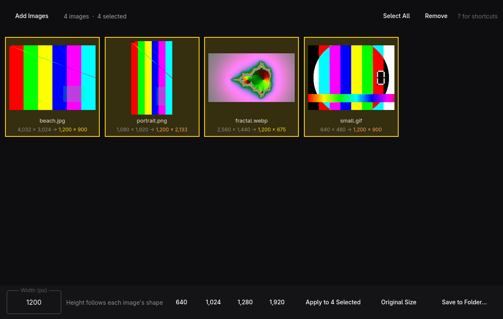

# Sizer



Resize a batch of images to one width and save the copies to a folder. Add
images (or drop them, or a whole folder, on the window), select some or all,
type a width, and Sizer works out each height so nothing gets stretched. Save
asks which folder the copies go into.

- Originals are never changed. A copy keeps its name, and when that name is
  taken in the folder it becomes `photo-1200w.jpg` instead of replacing anything.
- Copies keep their format (JPEG, PNG, WebP, TIFF, BMP); GIF becomes PNG, since
  Qt can't write GIF. JPEG and WebP are saved at quality 92.
- Phone photos come out upright: the EXIF rotation is applied.
- Save to Folder opens in the folder the images came from (the selected ones,
  or the first image). Add Images opens where you last added from, even after
  a restart; that folder is kept in `~/.config/sizer/sizer.ini`.
- Widths larger than the original are allowed and shown in orange.
- It follows the Omarchy theme as it changes.

## Shortcuts

| Key | Action |
| --- | --- |
| `A` / `Ctrl+O` | Add images |
| `W` | Type a new width |
| `Enter` | Apply the width (to the selection, or to all when nothing is selected) |
| `R` | Back to the original size |
| `Space` / `Ctrl+S` | Save to a folder |
| `Ctrl+A` | Select all |
| `Esc` | Select none |
| Arrows | Move; with `Shift`, extend the selection |
| `Ctrl+Click` / `Shift+Click` | Toggle / extend the selection |
| `Delete` | Remove from the list |
| `Ctrl+Z` / `Ctrl+Shift+Z` | Undo / redo |
| `?` | Show every shortcut |
| `Q` | Quit (asks first when resized images haven't been saved) |

## Command line

```sh
sizer open photos/                        # the window, with images loaded
sizer info photos/ --json                 # each image's size
sizer resize --width 1200 --out web/ photos/ --json
sizer skill install                       # teach coding agents to use sizer
```

`resize` and `info` exit 0 on success and 1 otherwise, with errors on stderr.

## Building

```sh
bin/build      # build/sizer
bin/test       # the Qt Test suite, offscreen
bin/install    # makepkg -fsi, so Sizer shows up in the app launcher
```

Needs `qmake6`, `make`, a C++17 compiler, and Qt 6 (base, declarative,
wayland, imageformats), all part of Omarchy.
